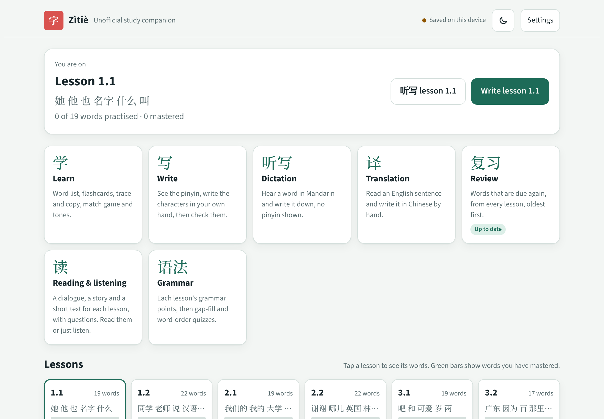
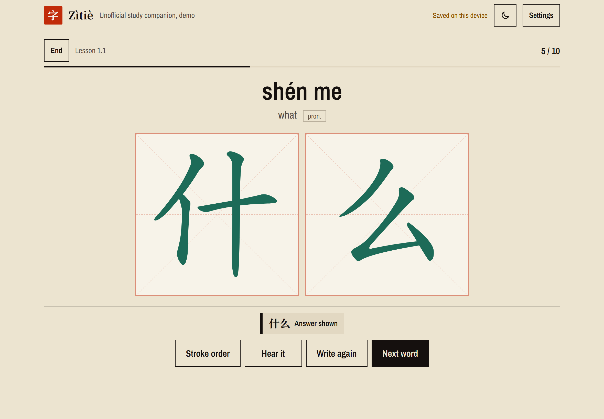

# Zìtiè 字帖: a handwriting-first Chinese trainer

Zìtiè is a study tool for English speakers learning Mandarin, built for an **iPad with an Apple Pencil** in Safari. You write every answer by hand, and the app marks your strokes against each character's real stroke order. It follows the lesson sequence of the textbook *Contemporary Chinese for Beginners* (simplified characters only). The full app covers 702 words over 39 lessons.

**This repository is a demo:** it includes only lessons 1.1 and 1.2 (41 words, with their reading passages, translation exercises and grammar). Every study mode works on those two lessons.

**Live demo:** https://andrewromundt.github.io/chinese-study-tool-public/ (progress is saved in your browser)

| Home | Write mode |
| --- | --- |
|  |  |

> This is an independent, unofficial project. It is not affiliated with, endorsed by, or connected to the publishers or authors of *Contemporary Chinese for Beginners*, and it contains none of the textbook's text, dialogues or exercises. You need your own copy of the book to follow the course.

## Highlights

- **Your own handwriting, marked fairly.** Each box is a pressure-sensitive canvas with palm rejection. Nothing is judged while you write; on **Check**, your strokes are normalised for size and position and compared with the character's stroke medians using a port of Hanzi Writer's stroke matcher. Strokes out of order or backwards show in amber, wrong shapes in red.
- **Three marking levels** (Standard, Lenient, Any stroke order), tuned with a simulator (`tests/sim.mjs`) that writes every character neatly, messily, upright and by finger: Standard passes 98-100% of correct characters while still catching every backwards stroke or wrong character and nearly every pair of strokes written in the wrong order. It allows for how handwriting differs from the brush font (hooks and flicks short or left off, flatter long strokes, dots judged only by where they sit, a tap counts as a dot, more room in small boxes), and each red stroke says what to fix, such as "1st stroke: start it lower".
- **Looks like a copybook.** Buff paper, ink rules and square edges, with the current lesson printed in 田字格 on Home.
- **A guided tour** from the welcome page (or Tutorial on Home) runs on the real screens: the page dims except a window onto each feature, which stays usable, and a card beside it explains, gliding from writing and Check, to hints, flashcards and what Again, Hard, Good and Easy do, reading, My words, then adding words from a photo (a sample photo is loaded to drag over) and by speech.
- **Spaced repetition** across every mode: misses come back in 10 minutes, hits climb an interval ladder.
- **Made for long sessions on the iPad.** Check, Next, Undo stroke and Clear box sit in a dock pinned to the bottom of the screen, so they stay in reach in either orientation and on a phone. Results show your own handwriting with the marks on it, like a corrected copybook page.
- **No build step, no framework.** The whole app is one HTML file plus its data files; the photo and speech models load only when used.

## Study modes

- **Learn**: word list, flashcards, trace and copy, a match game, a tone trainer, and free practice.
- **Write**: see pinyin and an English hint, write the characters. **Write again** gives a fresh, ungraded try with the answer hidden, and **It was right** overrules a wrong mark (with Undo).
- **Dictation (听写)**: hear the word and write it with no pinyin shown. The clue is sound only by default, as in a class 听写, or sound and meaning; words that sound like another course word always show their meaning (homophones such as 他/她, and words told apart only by a neutral tone or by tone changes in speech). **听写 lesson** on Home starts a dictation of the whole current lesson in one tap. Speech uses the best Mandarin voice installed on the device (on iPad, a downloaded Premium or Enhanced voice if there is one).
- **Translation (译)**: about 25 English sentences per lesson to write in Chinese by hand, each using only vocabulary taught so far. Common equivalent wordings are accepted (for example 但是/可是/不过, optional 很, time phrases before or after the subject).
- **Reading & listening**: a dialogue, a story and a short text for every lesson, with comprehension questions in Chinese. Tap a word to see just that word; Reveal translation shows the pinyin and English of the whole passage. Or listen with the text hidden.
- **Grammar**: each lesson's grammar points with spoken examples, then gap-fill and word-order quizzes.
- **Review**: every due word from all lessons, oldest first, in rounds of up to 20.
- **Flagged words**: flag a word from the word list, a flashcard or a reading passage, then practise just those.
- **My words**: add any word from the full dictionary (CC-CEDICT, simplified, about 116,000 entries), four ways, each ending on a screen with every reading of the word to choose from:
  - **Write it**: write a character and pick it from the 8 the app thinks it is; keep writing for longer words. The recogniser ranks all 7,174 characters against your strokes, and tolerates strokes out of order or run together.
  - **Pinyin or English**: `ni3hao3`, `nǐhǎo`, `nihao`, `你好` or `hello`. On iPad the box also takes Apple Pencil writing, Scan Text and keyboard dictation.
  - **Photo**: take or choose a photo, drag over the part you want, and tap the words found. PaddleOCR reads it on the device, handwriting included.
  - **Say it**: say a word or a sentence and tap the words you want. It uses the browser's speech recognition where it works, and otherwise (as in apps added to the Home Screen) OpenAI's Whisper running on the device.

  Your words become a lesson called My words, so every word mode works on them; the list can be reordered, edited and deleted. Photo and speech models download the first time they are used (about 30 MB and 77 MB) and then work offline; nothing is sent anywhere.

Also: lessons on Home open their word list; Write and 听写 can be checked with boxes left empty; Translation starts with one row of boxes and adds more as you write, so the box count never gives the answer away; a light/dark toggle; and keyboard shortcuts (Enter checks and moves on, Space and 1 to 4 run flashcards).

All reading passages, translation sentences, grammar explanations and quizzes in this repository were written for this project. The reading and translation builders reject any sentence that uses vocabulary from a later lesson.

## Run it

The app loads its JSON files from its own folder, so serve it over HTTP:

```
cd app
python3 -m http.server 8765
```

Open http://localhost:8765/ (or your computer's LAN address from an iPad on the same Wi-Fi). Hanzi Writer and the fonts are served from `app/` itself, so the app needs no CDN (it also loads where jsDelivr and Google Fonts are blocked).

`app/index.html` is written as a page body. `sh tools/standalone.sh` wraps it into a full page in `dist/` with a web app manifest and icon, so it can be added to the iPad home screen and open full screen. The live demo is that `dist/` folder on GitHub Pages, built by `.github/workflows/pages.yml` on every push to `main`.

Progress is stored in `localStorage`. When the page runs as a claude.ai Artifact it also syncs across devices through the Artifact database; to sync elsewhere, replace `connectDb()` / `flush()` in `index.html` with Firebase, Supabase or your own server.

## Layout

```
app/index.html                  the whole app (HTML, CSS, JS)
app/words.json                  vocabulary: id, lesson, characters, pinyin, short English hint, part of speech, tones
app/strokes.json                stroke data for every character used (from hanzi-writer-data)
app/lessons.json                reading texts, questions and grammar points per lesson
app/exercises/reading.json      a dialogue and a story per lesson, with pinyin, English and questions
app/exercises/translation.json  English-to-Chinese writing exercises per lesson
app/dict.txt                    CC-CEDICT, simplified only: characters, numbered pinyin, a short English gloss (loaded when you add a word)
app/hw.txt                      stroke shapes of 7,174 characters, coarsened, for handwriting recognition
app/t2s.txt                     traditional to simplified, character pairs, for speech recognised in traditional characters
app/strokes/                    full stroke data of characters outside the demo lessons, 64 shards loaded on demand
app/vendor/ppocr/               PaddleOCR PP-OCRv4 models (Apache 2.0) and ONNX Runtime Web (MIT), for reading photos
app/vendor/whisper/             Whisper base (MIT) on Transformers.js (Apache 2.0), for speech; the decoder is split into parts the app joins
data/vocab.tsv                  the word list: which words each lesson introduces
tools/make.py                   builds words.json and strokes.json from data/vocab.tsv, CC-CEDICT and hanzi-writer-data
tools/gloss.py                  looks up pinyin and short English hints in CC-CEDICT
tools/overrides.py              hand-picked pinyin, hints and display forms per word id
tools/reading/, reading_build.py       sources and builder for reading.json (rejects vocab from later lessons)
tools/translation/                     sources and builder for translation.json
tools/mywords_data.mjs          builds dict.txt, t2s.txt, hw.txt and strokes/ from CC-CEDICT and hanzi-writer-data
tools/subset_fonts.py           subsets the fonts in app/fonts/ to the characters the app uses
app/vendor/hanzi-writer.min.js  Hanzi Writer 3.7.2, served locally
app/og.png                      the link-preview image
tests/                          sim.mjs simulates handwriting against the real marker, recog.mjs against the recogniser (handwriting.mjs is the simulated writer), photo.mjs runs the photo reader on real photos; lessons-check.js checks app/lessons.json
```

## Rebuild the data

```
pip install pypinyin
npm pack hanzi-writer-data@2.0.1 && mkdir -p pkgs/hwd && tar -xzf hanzi-writer-data-2.0.1.tgz -C pkgs/hwd
# CC-CEDICT from https://www.mdbg.net/chinese/dictionary?page=cc-cedict, unzipped to pkgs/
gunzip -c cedict_1_0_ts_utf-8_mdbg.txt.gz > pkgs/cedict_1_0_ts_utf-8_mdbg.txt
cd app && python3 ../tools/make.py
```

After adding lessons or UI text, rerun `python3 tools/subset_fonts.py` (needs `pip install fonttools brotli` and the full Noto Serif SC and Archivo Narrow TTFs in `pkgs/fonts/`, see the script) so the fonts cover the new characters.

To fix a word's pinyin or hint, add an entry to `tools/overrides.py` keyed by its id. After editing `app/lessons.json`, run `node tests/lessons-check.js`. `deno run --allow-read tests/sim.mjs` (or `node tests/sim.mjs`) checks marking on every character; `tests/sim.mjs 你叫` breaks one down by stroke. `node tests/recog.mjs` writes every character in seven styles (neat to messy, finger, strokes swapped, strokes run together, parts moved) and reports how often the recogniser ranks it first and in the top 5. `node tests/photo.mjs` (needs `npm i puppeteer-core` and Chrome) runs the photo reader on real photos of handwritten Chinese from Wikimedia Commons, listed in `tests/photos.json` and downloaded on the first run (not kept in the repo). The My words data is rebuilt with `node tools/mywords_data.mjs <cedict.txt> <hanzi-writer-data package folder>`.

## Credits and licenses

- **Code and original content** (app, exercises, reading texts, grammar notes, tools, tests): MIT, see [LICENSE](LICENSE).
- **[Hanzi Writer](https://hanziwriter.org/)** by David Chanin (MIT, [license](licenses/hanzi-writer-MIT.txt)): renders hints, answers and stroke-order animations; the stroke matcher is ported from it. A copy is in `app/vendor/`.
- **[Noto Serif SC](https://github.com/notofonts/noto-cjk)** and **[Archivo Narrow](https://github.com/Omnibus-Type/ArchivoNarrow)** (SIL Open Font License 1.1, [Noto](licenses/OFL-NotoSerifSC.txt), [Archivo Narrow](licenses/OFL-ArchivoNarrow.txt)): subsets in `app/fonts/`.
- **[hanzi-writer-data](https://github.com/chanind/hanzi-writer-data)** (`app/strokes.json`): derived from [Make Me a Hanzi](https://github.com/skishore/makemeahanzi) and the Arphic PL fonts, under the [Arphic Public License](licenses/ARPHICPL.TXT).
- **[CC-CEDICT](https://cc-cedict.org/)** (MDBG and contributors): pinyin and English hints in `app/words.json` are derived from it under [CC BY-SA 4.0](https://creativecommons.org/licenses/by-sa/4.0/), so `app/words.json` is shared under the same license.
- **[CC-CEDICT](https://cc-cedict.org/)** again for My words: `app/dict.txt` and `app/t2s.txt` are derived from it and shared under [CC BY-SA 4.0](https://creativecommons.org/licenses/by-sa/4.0/); the app credits it in Settings. `app/strokes/` and `app/hw.txt` come from hanzi-writer-data (Arphic Public License).
- **[PaddleOCR](https://github.com/PaddlePaddle/PaddleOCR)** PP-OCRv4 models (Apache 2.0) and **[ONNX Runtime Web](https://github.com/microsoft/onnxruntime)** (MIT): reading photos, in `app/vendor/ppocr/` with their licences.
- **[Whisper](https://github.com/openai/whisper)** by OpenAI (MIT) on **[Transformers.js](https://github.com/huggingface/transformers.js)** (Apache 2.0): speech, in `app/vendor/whisper/` with their licences.
- **[pypinyin](https://github.com/mozillazg/python-pinyin)** (MIT): pinyin for words not in CC-CEDICT and for the reading and translation texts.

*Contemporary Chinese for Beginners* is named only to describe which course the lesson order follows; the title belongs to its publisher.
