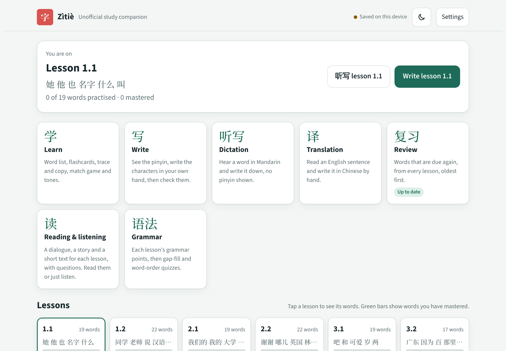
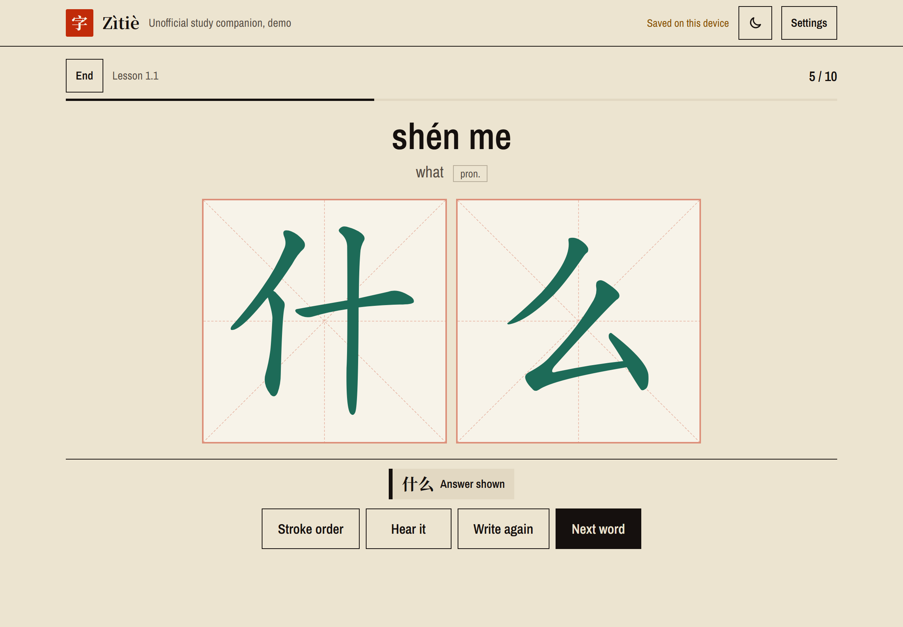

# Zìtiè 字帖: a handwriting-first Chinese trainer

Zìtiè is a study tool for English speakers learning Mandarin, built for an **iPad with an Apple Pencil** in Safari. You write every answer by hand, and the app marks your strokes against each character's real stroke order. It follows the lesson sequence of the textbook *Contemporary Chinese for Beginners* (simplified characters only). The full app covers 702 words over 39 lessons.

**This repository is a demo:** it includes only lessons 1.1 and 1.2 (41 words, with their reading passages, translation exercises and grammar). Every study mode works on those two lessons.

**Live demo:** https://andrewromundt.github.io/chinese-study-tool-public/ (progress is saved in your browser)

| Home | Write mode |
| --- | --- |
|  |  |

> This is an independent, unofficial project. It is not affiliated with, endorsed by, or connected to the publishers or authors of *Contemporary Chinese for Beginners*, and it contains none of the textbook's text, dialogues or exercises. You need your own copy of the book to follow the course.

## Highlights

- **Your own handwriting, marked fairly.** Each box is a pressure-sensitive canvas with palm rejection. Nothing is judged while you write; on **Check**, your strokes are normalised for size and position and compared with the character's stroke medians using a port of Hanzi Writer's stroke matcher. Strokes out of order or backwards show in amber, wrong shapes in red.
- **Three marking levels** (Standard, Lenient, Any stroke order), tuned with a simulator (`tests/sim.js`) that writes thousands of noisy characters: Standard passes about 93% of correct, wobbly characters while still catching every out-of-order or backwards stroke.
- **Spaced repetition** across every mode: misses come back in 10 minutes, hits climb an interval ladder.
- **Made for long sessions on the iPad.** Check, Next, Undo stroke and Clear box sit in a dock pinned to the bottom of the screen, so they stay in reach in either orientation and on a phone. Results show your own handwriting with the marks on it, like a corrected copybook page.
- **No build step, no framework.** The whole app is one HTML file plus a few JSON data files.

## Study modes

- **Learn**: word list, flashcards, trace and copy, a match game, a tone trainer, and free practice.
- **Write**: see pinyin and an English hint, write the characters. **Write again** gives a fresh, ungraded try with the answer hidden, and **It was right** overrules a wrong mark (with Undo).
- **Dictation (听写)**: hear the word and write it with no pinyin shown. The clue is sound only by default, as in a class 听写, or sound and meaning; course homophones such as 他/她 always show their meaning. **听写 lesson** on Home starts a dictation of the whole current lesson in one tap. Speech uses the best Mandarin voice installed on the device (on iPad, a downloaded Premium or Enhanced voice if there is one).
- **Translation (译)**: about 25 English sentences per lesson to write in Chinese by hand, each using only vocabulary taught so far. Common equivalent wordings are accepted (for example 但是/可是/不过, optional 很, time phrases before or after the subject).
- **Reading & listening**: a dialogue, a story and a short text for every lesson, with comprehension questions in Chinese. Tap any sentence for pinyin and English, or listen with the text hidden.
- **Grammar**: each lesson's grammar points with spoken examples, then gap-fill and word-order quizzes.
- **Review**: every due word from all lessons, oldest first, in rounds of up to 20.
- **Flagged words**: flag a word from the word list, a flashcard or a reading passage, then practise just those.

Also: lessons on Home open their word list; Write and 听写 can be checked with boxes left empty; Translation starts with one row of boxes and adds more as you write, so the box count never gives the answer away; a light/dark toggle; and keyboard shortcuts (Enter checks and moves on, Space and 1 to 4 run flashcards).

All reading passages, translation sentences, grammar explanations and quizzes in this repository were written for this project. The reading and translation builders reject any sentence that uses vocabulary from a later lesson.

## Run it

The app loads its JSON files from its own folder, so serve it over HTTP:

```
cd app
python3 -m http.server 8765
```

Open http://localhost:8765/ (or your computer's LAN address from an iPad on the same Wi-Fi). Hanzi Writer and the fonts are served from `app/` itself, so the app needs no CDN (it also loads where jsDelivr and Google Fonts are blocked).

`app/index.html` is written as a page body. `sh tools/standalone.sh` wraps it into a full page in `dist/` with a web app manifest and icon, so it can be added to the iPad home screen and open full screen. The live demo is that `dist/` folder on GitHub Pages, built by `.github/workflows/pages.yml` on every push to `main`.

Progress is stored in `localStorage`. When the page runs as a claude.ai Artifact it also syncs across devices through the Artifact database; to sync elsewhere, replace `connectDb()` / `flush()` in `index.html` with Firebase, Supabase or your own server.

## Layout

```
app/index.html                  the whole app (HTML, CSS, JS)
app/words.json                  vocabulary: id, lesson, characters, pinyin, short English hint, part of speech, tones
app/strokes.json                stroke data for every character used (from hanzi-writer-data)
app/lessons.json                reading texts, questions and grammar points per lesson
app/exercises/reading.json      a dialogue and a story per lesson, with pinyin, English and questions
app/exercises/translation.json  English-to-Chinese writing exercises per lesson
data/vocab.tsv                  the word list: which words each lesson introduces
tools/make.py                   builds words.json and strokes.json from data/vocab.tsv, CC-CEDICT and hanzi-writer-data
tools/gloss.py                  looks up pinyin and short English hints in CC-CEDICT
tools/overrides.py              hand-picked pinyin, hints and display forms per word id
tools/reading/, reading_build.py       sources and builder for reading.json (rejects vocab from later lessons)
tools/translation/                     sources and builder for translation.json
tools/card.js, learn.js         standalone copies of the marking and Learn-mode code
tools/subset_fonts.py           subsets the fonts in app/fonts/ to the characters the app uses
app/vendor/hanzi-writer.min.js  Hanzi Writer 3.7.2, served locally
app/demo.mp4, og.png            the clip on the welcome screen and the link-preview image
tests/                          Playwright scripts that simulate Pencil strokes; sim.js measures marking acceptance
```

## Rebuild the data

```
pip install pypinyin
npm pack hanzi-writer-data@2.0.1 && mkdir -p pkgs/hwd && tar -xzf hanzi-writer-data-2.0.1.tgz -C pkgs/hwd
# CC-CEDICT from https://www.mdbg.net/chinese/dictionary?page=cc-cedict, unzipped to pkgs/
gunzip -c cedict_1_0_ts_utf-8_mdbg.txt.gz > pkgs/cedict_1_0_ts_utf-8_mdbg.txt
cd app && python3 ../tools/make.py
```

After adding lessons or UI text, rerun `python3 tools/subset_fonts.py` (needs `pip install fonttools brotli` and the full Noto Serif SC and Source Sans 3 TTFs in `pkgs/fonts/`, see the script) so the fonts cover the new characters.

To fix a word's pinyin or hint, add an entry to `tools/overrides.py` keyed by its id. After editing `app/lessons.json`, run `node tests/lessons-check.js`. The other tests need Playwright with Chromium and a local Hanzi Writer at `pkgs/hw/package/dist/hanzi-writer.min.js` (`npm pack hanzi-writer@3.7.2`).

## Credits and licenses

- **Code and original content** (app, exercises, reading texts, grammar notes, tools, tests): MIT, see [LICENSE](LICENSE).
- **[Hanzi Writer](https://hanziwriter.org/)** by David Chanin (MIT, [license](licenses/hanzi-writer-MIT.txt)): renders hints, answers and stroke-order animations; the stroke matcher is ported from it. A copy is in `app/vendor/`.
- **[Noto Serif SC](https://github.com/notofonts/noto-cjk)** and **[Source Sans 3](https://github.com/adobe-fonts/source-sans)** (SIL Open Font License 1.1, [Noto](licenses/OFL-NotoSerifSC.txt), [Source Sans](licenses/OFL-SourceSans3.txt)): subsets in `app/fonts/`.
- **[hanzi-writer-data](https://github.com/chanind/hanzi-writer-data)** (`app/strokes.json`): derived from [Make Me a Hanzi](https://github.com/skishore/makemeahanzi) and the Arphic PL fonts, under the [Arphic Public License](licenses/ARPHICPL.TXT).
- **[CC-CEDICT](https://cc-cedict.org/)** (MDBG and contributors): pinyin and English hints in `app/words.json` are derived from it under [CC BY-SA 4.0](https://creativecommons.org/licenses/by-sa/4.0/), so `app/words.json` is shared under the same license.
- **[pypinyin](https://github.com/mozillazg/python-pinyin)** (MIT): pinyin for words not in CC-CEDICT and for the reading and translation texts.

*Contemporary Chinese for Beginners* is named only to describe which course the lesson order follows; the title belongs to its publisher.
